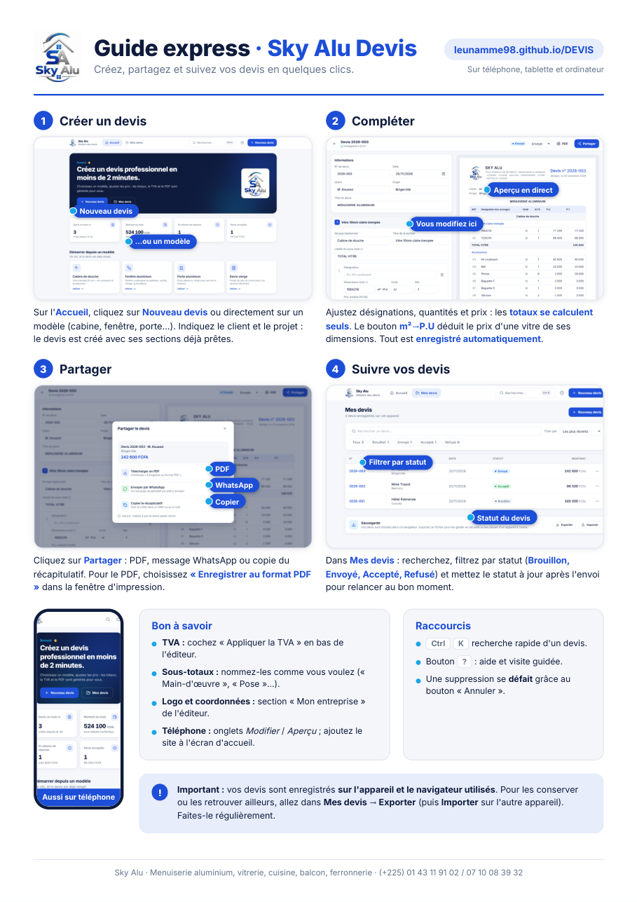

# DEVIS – Générateur de devis (Sky Alu)

Application Angular légère pour créer, imprimer (PDF) et sauvegarder des devis.
Les données sont stockées dans le navigateur (localStorage) ; export/import JSON disponible.

- Code : `devis-app/`
- Modèle d'origine : `docs/`

## Guide d'utilisation
Guide express d'une page (illustré) : **[Guide-Sky-Alu-Devis.pdf](docs/Guide-Sky-Alu-Devis.pdf)**

[](docs/Guide-Sky-Alu-Devis.pdf)

La source du guide est `docs/guide/guide.html` (à ouvrir dans un navigateur, puis Imprimer → Enregistrer au format PDF).

## Charte graphique
Palette « Sky Alu » définie une seule fois dans `devis-app/src/styles.css` (bloc `@theme`).
`--color-*: initial` supprime toutes les couleurs Tailwind par défaut : seules les couleurs de la charte existent.

| Rôle | Couleur |
|---|---|
| Primaire | `#1E4FD8` |
| Marine (texte) | `#0F1B3D` |
| Accent | `#19A7E6` |
| Fond / surface / bordure / texte secondaire | `#F5F7FB` / `#FFFFFF` / `#E2E8F0` / `#64748B` |
| Succès / alerte / danger (statuts, erreurs) | `#16A34A` / `#F59E0B` / `#DC2626` |

Le devis imprimé garde son propre thème « document » (variables `--doc-*`).

**Pile :** Angular 22 · Tailwind CSS 4 · Angular CDK (dialogues, menus, infobulles, glisser-déposer) · Lucide · Inter.

## Développement
```
cd devis-app
npm install
npx ng serve
```

## Déploiement
Chaque push sur `main` construit l'application et la publie sur GitHub Pages
(`.github/workflows/deploy.yml`). Réglage unique : *Settings → Pages → Source : GitHub Actions*.
